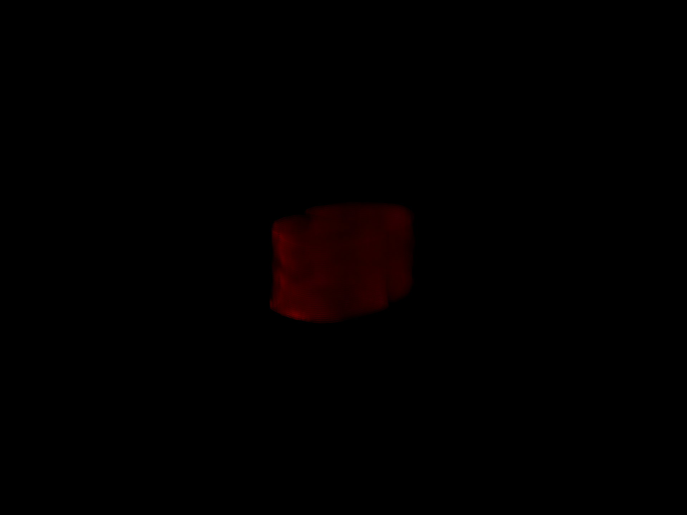
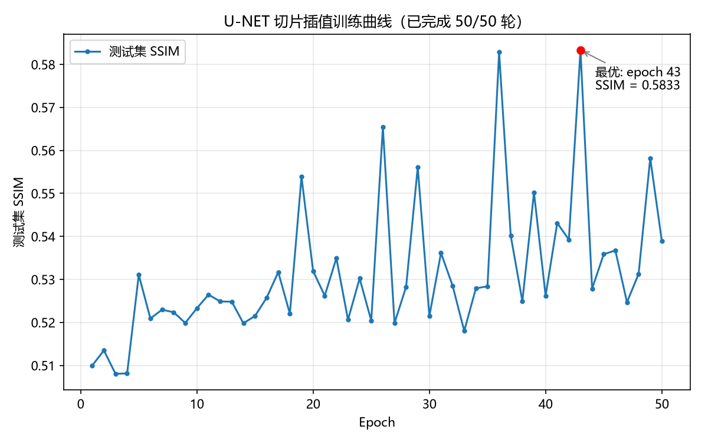

# SRT｜小鼠脑切片三维重建

基于小鼠脑连续切片，探索传统插值与深度学习对切片补全和三维重建的作用。

当前仓库以 **Jupyter Notebook 算法实验**为主，已有线性插值、四点三次多项式插值、U-Net 中间切片预测及切片堆叠可视化。后续目标是完善配准、统一评估与重建流程，并逐步封装为便于使用的工具。

> 本说明根据 2026-10-23 的仓库代码及 Notebook 已保存输出整理。保存的实验结果不代表在新环境中重新运行验证；计划中的功能与当前实现分别列出。

## 1. 工作区导航

| 路径 | 内容与用途 |
| --- | --- |
| [Programming/插值算法/work1.ipynb](Programming/插值算法/work1.ipynb) | 读取切片、统一尺寸、线性插值、PyVista 三维堆叠渲染 |
| [Programming/插值算法/work2.ipynb](Programming/插值算法/work2.ipynb) | 四点三次多项式插值，包含逐像素教学实现和 NumPy 向量化实现 |
| [Programming/UNET/U-NET.ipynb](Programming/UNET/U-NET.ipynb) | 数据集构造、U-Net、训练、SSIM 评估与曲线绘制 |
| [Working__stack/](Working__stack/) | 已保存的堆叠渲染、SSIM 曲线及测试图片 |
| [Literature/](Literature/) | GAN、GANsformer、NeRF、Style-NeRF 等参考资料；对应方法尚未在仓库实现 |
| [SRT Commission.pdf](SRT%20Commission.pdf) | 项目说明材料 |
| [WT10 0.5mm_72h_1_s01c2.zip](WT10%200.5mm_72h_1_s01c2.zip) | 切片数据压缩包，约 82 MB；仓库说明记录其为 10 张切片的子集 |
| [.github/copilot-instructions.md](.github/copilot-instructions.md) | 面向代码助手的项目约定；部分历史状态说明已落后于当前目录结构 |

建议阅读顺序：**work1 → work2 → U-NET**。结果图片集中放在 `Working__stack`，算法代码集中放在 `Programming`。

## 2. 当前实现与进度

### 线性插值：work1.ipynb

- 按文件名排序读取 PNG，将图像缩放为第一张的尺寸。
- 示例使用前 10 张原图，相邻两张间插入 3 张线性插值图，共 37 张切片。
- 插值形式为 `I(t) = (1-t) × I_a + t × I_b`，默认 `t = 0.25, 0.50, 0.75`。
- 提供惰性读取与切片生成器，并将图像映射为 PyVista 纹理平面，导出 PNG。

这一路径实现的是像素强度混合及三维切片堆叠显示；统一图像尺寸本身不等于解剖结构配准。

### 三次多项式插值：work2.ipynb

- 用 4 张切片在相同像素位置的 RGB 值拟合三次多项式。
- 包含逐像素解方程的原型，以及预计算 Lagrange 权重后对整张图加权求和的向量化版本。
- 示例使用前 10 张原图，每两张间插入 1 张，共 19 张切片；末端使用最后 4 张源图。
- 这是**局部四点三次多项式插值**，并非已实现带导数连续约束的分段三次样条。
- 最后一个单元格仅留下重写插值评估逻辑的草稿，尚未完成。

### 深度学习：U-NET.ipynb

任务为：输入 `I_i` 与 `I_(i+2)`，预测真实中间切片 `I_(i+1)`。

| 项目 | 当前代码设置 |
| --- | --- |
| 输入与输出 | 2 通道输入 → 1 通道输出；RGB 图像仅取 R 通道 |
| 数据构造 | 连续三元组，共用裁剪坐标；超出图像边界的部分补零 |
| 裁剪尺寸 | **512 × 512**；部分旧注释仍写 1024，以代码为准 |
| 每组三元组采样数 | 每轮 20 个随机裁剪 |
| 数据划分 | 59 张图形成 57 个三元组；40 组训练、17 组评估，即 800 / 340 个裁剪 |
| 模型 | 三次下采样的 U-Net，编码通道 32 → 64 → 128，瓶颈 256 |
| 优化 | Adam，学习率 `1e-4`，batch size 2，50 epochs |
| 训练损失 | `MSELoss`；梯度平滑正则项尚未加入 |
| 评估 | 预测截断至 [0, 1] 后逐图计算 SSIM，再取平均 |
| 设备 | 自动选择 CUDA 或 CPU，`num_workers=0` |

Notebook 已保存输出：首轮 SSIM **0.5100**，最高 **0.5833（epoch 43）**，末轮 **0.5389**。这些是当前局部裁剪和划分协议下的探索性结果，尚不能据此判断 U-Net 优于传统插值。

**评估边界：**按三元组划分避免了同一三元组的裁剪直接混入两侧，但相邻三元组仍可能共享原始切片。每轮监测的“测试集”也实际承担了验证集的作用。独立泛化评估应另设按动物、序列或不重叠切片区段划分的留出集，并隔离跨边界三元组。

## 3. 数据准备

目前 Notebook 使用的本地数据目录为：

```text
E:\working_stack\WT10 0.5mm_72h
```

已保存输出显示该目录有 59 张 RGB PNG，首张尺寸为 `3571 × 5113 × 3`，不同切片尺寸不完全相同。完整数据目录不在当前仓库中；根目录压缩包为数据子集。

运行前需要：

1. 准备完整切片数据，或解压仓库中的子集用于小规模探索。
2. 将 Notebook 中的 `folder_path`、`FOLDER` 改为本机实际 PNG 目录。
3. 核对文件名排序与真实切片顺序，检查缺失切片和物理间距。当前实现主要按列表索引处理，未根据缺片编号自动恢复真实 z 坐标。
4. 将所有 `OUTPUT_PNG` 改为有效输出路径，并提前创建父目录。

U-Net 直接使用相同像素坐标裁剪，不自动解决切片间旋转、平移或组织形变。更换数据时，也应确认仅使用 R 通道是否合适。

## 4. 环境与运行

仓库尚无锁定版本的依赖清单、独立命令行入口或自动化测试。Notebook 元数据记录 Python 3.12.14，原开发内核显示名为 `cellpose`；该名称不表示代码依赖 Cellpose 分割模型。

可从以下基础环境开始安装，具体版本需结合本机设备验证：

```bash
git clone https://github.com/lyn14/SRT.git
cd SRT
python -m venv .venv
```

激活虚拟环境后安装依赖：

```bash
python -m pip install jupyterlab ipykernel numpy Pillow matplotlib pyvista torch torchmetrics
python -m ipykernel install --user --name srt --display-name "Python (SRT)"
jupyter lab
```

需要 GPU 训练时，另按本机驱动与 CUDA 兼容情况选择 PyTorch 安装方式。在 Jupyter 中选择已安装上述依赖的内核。

### 建议运行方式

1. 先修改数据和输出路径。
2. 首次使用少量切片检查读取、尺寸与顺序，再运行完整实验。
3. `work1` 按数据依赖执行，先确认生成切片的数量，再渲染。
4. `work2` 优先使用向量化插值；逐像素整图拟合单元格耗时很长，渲染前还需处理下列已知问题。最后的草稿单元格应跳过。
5. `U-NET` 按顺序运行，先检查样本形状与取值范围，再启动训练。

## 5. 已知复现问题与资源开销

| 问题 | 当前情况与处理方式 |
| --- | --- |
| 输出目录名称 | 仓库是 `Working__stack`（双下划线）；插值 Notebook 的旧路径写成 `Working_stack`，需要修改 |
| work2 渲染变量 | 渲染单元格内计算 `h, w` 的语句被注释，后面却仍使用它们；干净内核下需先定义平面尺寸 |
| work2 未完成调用 | 最后无参数的 `interp_image_fast()` 会报错，需跳过或补全 |
| 渲染降采样 | 两个插值 Notebook 的图像缩小语句被注释，当前仍上传完整图像纹理；仅修改 `RENDER_SCALE` 不会真正减少纹理分辨率 |
| 内存与显存 | 数千像素宽的 RGB 切片开销较大；work1 的生成器仅优化该阶段的数据加载，前面单元格仍会一次性载入全部图片，GPU 也会保留已添加纹理 |
| 离屏渲染 | 使用 `off_screen=True`；项目记录原环境开启 depth peeling 会产生全黑图片 |
| 结果保存 | U-Net 曲线以相对路径 `ssim_curve.png` 保存，实际位置取决于运行工作目录 |
| 模型权重 | 当前训练代码未实现 checkpoint 保存；仓库没有已提交的训练权重或完整切片推理导出流程 |

例如，59 张统一为 `3571 × 5113` 的 RGB 图片，仅像素数组约占 **3.0 GiB（uint8）**，全量转为 float32 约 **12.0 GiB**，还未计入插值、纹理与训练激活。现有部分注释中的 0.9 GB 估计不适用于这一 RGB 尺寸。

## 6. 已有结果预览

图片来自仓库已保存结果，不构成统一设置下的算法比较。

| 线性插值切片堆叠 | 三次多项式插值切片堆叠 |
| --- | --- |
|  |  |



## 7. 下一步工作

- [ ] 修复路径、渲染变量和未完成单元格，整理依赖与配置，使 Notebook 能在干净内核中复现。
- [ ] 建立切片顺序、真实间距、缺失情况与配准结果的统一数据记录。
- [ ] 在相同留出切片、预处理、通道和预测位置上比较线性、三次多项式与 U-Net；显示用 z 轴拉伸独立设置。
- [ ] 完善独立训练/验证/测试划分，并结合图像误差与解剖结构保真度评估。
- [ ] 保存模型权重与实验配置，补充分块整图推理、切片导出及重建流程。
- [ ] 在稳定流程基础上探索平滑正则项、不同切片稀疏度和 GUI 封装。

当前仓库未包含 Allen 脑图谱配准、GAN/NeRF 实现或 GUI。上述内容属于后续探索方向。
